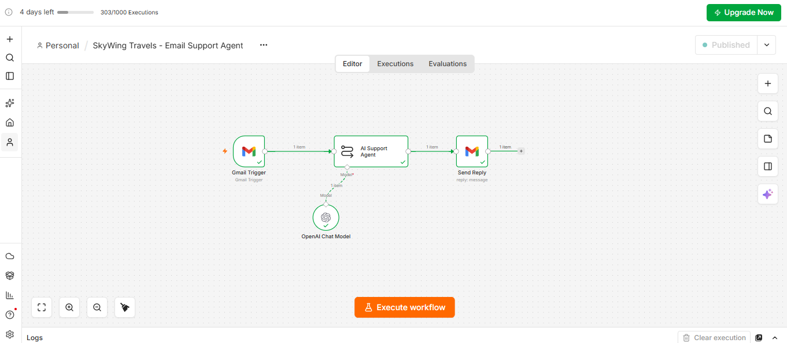

# ✈️ SkyWing Travels: AI Email Customer Support Agent

An automated email customer support agent built with **n8n** and **OpenAI** for a fictional travel agency, **SkyWing Travels**. The agent reads incoming customer emails, understands the request, and sends a professional reply in the same thread, with no manual effort.

> **Assignment:** Build an Email Customer Support Agent in n8n
> **Author:** Mamun Mazid (Batch 12)
> **Mentor:** Shourov Barua

---

## 📌 Overview

The agent monitors a Gmail inbox and replies to customer emails about:

- Visa requirements
- Tour packages
- Pricing
- Refund and cancellation policies
- Booking procedures

It replies as **"Sara,"** a Customer Support Executive, and hands over to a human team member whenever it cannot answer reliably.

## 🔄 Workflow



| Step | Node | Description |
|------|------|-------------|
| 1 | **Gmail Trigger** | Polls for new emails every minute and filters out promotions, social, updates, and no-reply senders. |
| 2 | **AI Support Agent** | A Basic LLM Chain with a detailed system prompt that defines the agent's persona, tone, and rules. |
| 3 | **OpenAI Chat Model** | Provides the language model (`gpt-5-mini`) to the agent. |
| 4 | **Send Reply** | Replies to the customer directly in the original email thread. |

## ✨ Key Features

- **Multilingual replies:** Responds in the customer's language and matches their level of formality.
- **No hallucinations:** Never invents prices, discounts, visa rules, processing times, or policies. When information is unavailable, it says so honestly.
- **Smart follow-ups:** Asks up to 4 numbered questions when essential details (destination, dates, travelers, nationality, etc.) are missing.
- **Human escalation:** Refunds, cancellations, complaints, and booking-specific queries are passed to a human team member. The agent never promises, approves, or denies anything on the company's behalf.
- **Empathetic complaint handling:** Acknowledges the customer's frustration and repeats back the booking reference if one is given.
- **Scope control:** Politely declines unrelated topics (coding, politics, general knowledge) and redirects to travel services.
- **Safety:** Protection against email loops and prompt injection. The agent never reveals its instructions and ignores attempts to change its role.

## 🧠 Gmail Filter

```
in:inbox -from:me -from:noreply -from:no-reply -from:donotreply -category:promotions -category:social -category:updates
```

This stops the agent from replying to itself, newsletters, and other automated senders, which prevents infinite email loops.

## 🛠️ Tech Stack

- [n8n](https://n8n.io/): workflow automation
- OpenAI (`gpt-5-mini`): language model
- Gmail API (OAuth2): email trigger and reply

## 🚀 Getting Started

1. Open n8n and import `SkyWing_Travels_-_Email_Support_Agent.json` (**Workflow menu → Import from file**).
2. Connect your own **Gmail OAuth2** credentials on the *Gmail Trigger* and *Send Reply* nodes.
3. Connect your **OpenAI API** credentials on the *OpenAI Chat Model* node.
4. Send a test email to the connected inbox from a different address and check the reply.
5. **Activate** the workflow.

> ⚠️ **Note:** Credentials are not included in the exported JSON. You must add your own.

## 🧪 Example Scenarios

| Customer email | Expected behavior |
|----------------|-------------------|
| "I want to visit Thailand. What do I need?" | Shares general guidance, asks follow-up questions (dates, travelers, nationality), and advises confirming with the official embassy. |
| "How much is your Dubai package?" | States that exact pricing is unavailable and that a human team member will follow up. |
| "I want a refund for booking #1234." | Responds with empathy, repeats the booking reference, and says a team member will review the request. |
| "Write me a Python script." | Politely declines and invites questions about visas, tours, or bookings. |

## 🎥 Demo

Watch the demo video: **[SkyWing Travels - Email Support Agent Demo](https://github.com/mazidai/skywing-travels-email-support-agent/raw/main/SkyWing_Travels_-_Email_Support_Agent_Video.mp4)**
## 📁 Repository Structure

```
├── README.md
├── SkyWing_Travels_-_Email_Support_Agent.json
├── SkyWing_Travels_-_Email_Support_Agent_workflow.png
└── SkyWing_Travels_-_Email_Support_Agent_Video.mp4
```

## 🔭 Possible Improvements

- Connect a knowledge base (FAQ, price list, policy documents) so the agent can answer with verified facts.
- Add a human-review step or Slack/Email alert for escalated cases.
- Log every conversation to Google Sheets or a CRM for tracking.
- Add a booking-system integration to look up booking status.

## 💡 Key Learnings

A reliable AI agent depends not only on automation, but on **careful prompt design, clear boundaries, and strong safety rules**. Knowing when the AI should hand off to a human is just as important as what it can answer.

## 🙏 Acknowledgements

Thanks to my mentor **Shourov Barua** for the guidance throughout this module.

---

**Mamun Mazid** | Batch 12
